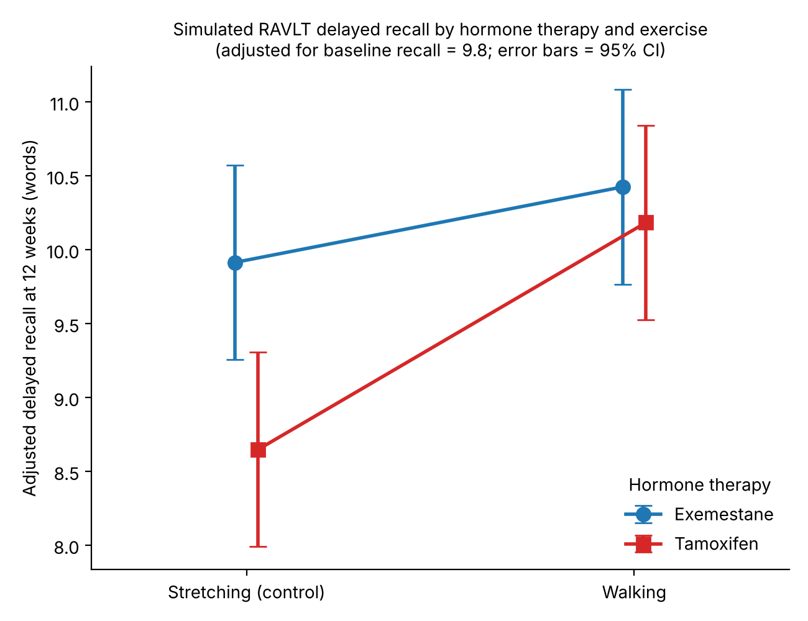
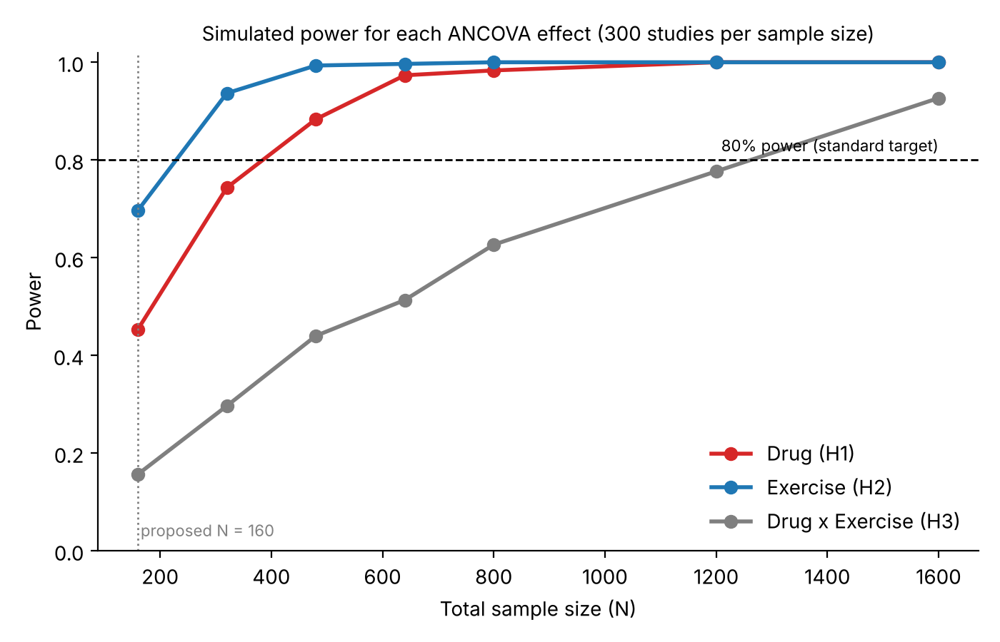

# **Exercise, Hormone Therapy, and Verbal Memory: A Simulation and Power Analysis of a Proposed RAVLT Study**

**This project simulates data for a research proposal I wrote for PSY 10A (Research Methods) at UC Santa Barbara, then runs the planned analysis and a power analysis in Python to test whether the proposed study could detect its hypothesized effects.**

> Simulated data only -- no real participants.

---

## Background

**Postmenopausal women with breast cancer are often treated with adjuvant endocrine therapy such as tamoxifen or exemestane. Tamoxifen has been linked to lower verbal memory, while exemestane has not (Schilder et al., 2010). Aerobic exercise improves episodic memory in older adults (Aghjayan et al., 2022). My proposal asks whether a walking program could offset the memory effects of hormone therapy, and whether it helps more for women on tamoxifen.**

## Hypotheses

1. It is expected that women taking tamoxifen will recall fewer words on the delayed recall trial compared to women in the exemestane group.
2. Additionally, I predict women randomly assigned to the 12-week walking program will recall more words than women in the stretching control.
3. I predict an interaction between hormone therapy type and exercise condition, such that the benefit of exercise on performance in the delayed recall trial will be larger in women taking tamoxifen than in women taking exemestane, as those taking tamoxifen start with a bigger memory deficit consistent with Schilder et al. (2010), giving more room for improvement.

## Study design

- **2 x 2 between-subjects quasi-experimental design**
  - **Hormone therapy (not randomized): tamoxifen vs. exemestane**
  - **Exercise (randomized): 12-week walking program vs. stretching control**
- **N = 160 postmenopausal women (40 per group)**
- **Women enroll within a month of starting their hormone therapy, so both drug groups start at the same memory level**
- **Outcome: Rey Auditory Verbal Learning Test (RAVLT) delayed recall (0-15 words) at 12 weeks**
- **Analysis: ANCOVA with baseline delayed recall as the covariate**

## Simulation assumptions

| Assumption | Value | Source |
|---|---|---|
| Baseline delayed recall | Mean = 10, SD = 3 (out of 15) | For women in the Geffen normative dataset, the mean Delayed Recall (Trial A7) is 10.0 words (SD = 3.4) for ages 50–59 and 10.2 words (SD = 2.5) for ages 60–69 (Geffen's normative dataset for adult females, as compiled in A Compendium of Neuropsychological Tests) |
| Baseline to follow-up correlation | r = 0.70 | **Published RAVLT test-retest reliability ranges from about 0.60 to 0.80** |
| Tamoxifen deficit (H1) | 1.0 word | **Schilder et al. (2010) found d = 0.43 vs. healthy controls (about 1.3 words); 1.0 is a conservative estimate vs. exemestane** |
| Walking benefit (H2, H3) | +1.2 words (tamoxifen), +0.5 words (exemestane) | **Average of about 0.85 words matches the meta-analysis effect (g = 0.28) in Aghjayan et al. (2022); the split between drug groups is my own assumption based on H3** |
| Group size | 40 per group | **From my proposal** |

## What the code does

The notebook has five cells. **Run them in order (Runtime -> Run all in Google Colab).**

1. **Simulation** -- builds the 4 groups, gives every participant a baseline score, then a 12-week follow-up score based on her group and baseline. Scores are rounded to whole words between 0 and 15 to make them more realistic.
2. **ANCOVA** -- **tests delayed recall by drug, exercise, and their interaction, controlling for baseline recall (Type III sums of squares, same as SPSS), and reports partial eta squared and adjusted means.**
3. **Assumption checks** -- **homogeneity of regression slopes, homogeneity of variance (Levene's test), normality of residuals (Shapiro-Wilk and Q-Q plot), and linearity.**
4. **Results figure** -- **adjusted means with 95% confidence intervals.**
5. **Power analysis** -- **repeats the whole simulated study 300 times at each of 7 sample sizes and counts how often each effect comes out significant.**

## Results

| Effect | F | p | Partial eta squared |
|---|---|---|---|
| Drug (H1) | 5.09 | .025 | .032 |
| Exercise (H2) | 9.46 | .002 | .058 |
| Drug x Exercise (H3) | 2.37 | .126 | .015 |

**In the simulated data, H1 and H2 were supported. The interaction went in the predicted direction (walking added about 1.5 words for tamoxifen vs. about 0.5 for exemestane) but was not significant. All ANCOVA assumptions were met, which is expected since the simulation built them in; the checks are included so the code is ready to use on real data.**

## Power analysis

| Effect | Power at N = 160 | N needed for 80% power |
|---|---|---|
| Exercise (H2) | 70% | about 240 |
| Drug (H1) | 45% | about 400 |
| Drug x Exercise (H3) | 16% | about 1,250 |

## Key takeaway

**With the proposed sample of 160, the study would have only about 16% power to detect the hypothesized interaction, my main hypothesis. Detecting it would take roughly 1,250 participants. This is consistent with interactions generally needing much larger samples than main effects. Possible changes to the design: a multi-site study, a longer follow-up (Schilder et al. measured after 1 year, when the tamoxifen deficit may be larger), or treating H3 as exploratory.**

## Limitations

- **All data are simulated, so the results only reflect the assumptions I put in.**
- **The tamoxifen deficit comes from 1-year data (Schilder et al., 2010); after only 12 weeks the real deficit may be smaller.**
- **Schilder et al. (2010) report the tamoxifen deficit vs. healthy controls; the abstract does not give a direct tamoxifen vs. exemestane effect size for verbal memory.**
- **The size of the interaction is my own assumption, since no published study has tested it.**

## How to run

**Open `ravlt_simulation.ipynb` in Google Colab and click Runtime -> Run all. Packages used: numpy, pandas, statsmodels, scipy, matplotlib (all preinstalled in Colab). The random seed is fixed, so results are the same every run.**

## References

- **Aghjayan, S. L., et al. (2022). Aerobic exercise improves episodic memory in late adulthood: a systematic review and meta-analysis. *Communications Medicine*, 2, 15.**
- **Schilder, C. M., Seynaeve, C., Beex, L. V., Boogerd, W., et al. (2010). Effects of tamoxifen and exemestane on cognitive functioning of postmenopausal patients with early breast cancer: results from the neuropsychological side study of the Tamoxifen and Exemestane Adjuvant Multinational trial. *Journal of Clinical Oncology*, 28(8), 1294-1300.**
- **Strauss, E., Sherman, E. M. S., & Spreen, O. (2006). *A Compendium of Neuropsychological Tests* (3rd ed.). Oxford University Press.**

## Note on AI use

**Code was developed with AI assistance (Claude). The research question, study design, hypotheses, and interpretation are my own.**
